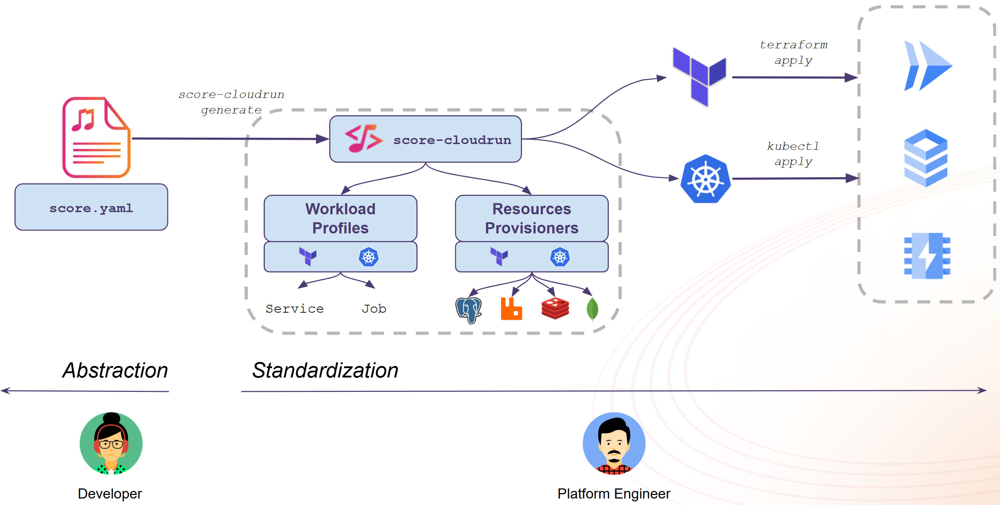

# `score-cloudrun`

`score-cloudrun` is a Score implementation of the [Score specification](https://score.dev/) for [Google Cloud Run](https://cloud.google.com/run).

## Why `score-cloudrun`?

The promise of Score (CNCF Sandbox) is:

> Score is loved by developers because they can deploy the same workload on completely different platforms, without being an expert in any of them.



On the other hand, Cloud Run is a very [appealing managed Platform to run containers](https://www.linkedin.com/pulse/cloud-run-power-kubernetes-simplicity-serverless-julien-breux-eq30f):

> Cloud Run has reached an impressive level of maturity. It now offers 90% of Kubernetes' power (scaling, multi-container, jobs, GPUs) for 10% of the operational overhead.

Here are some key features of `score-cloudrun`, bringing the advantages of both, Score and Cloud Run:
1. Simple interface and contract as declarative YAML file that the Devs author;
2. Implementation details made by the PEs, abstracting from the Devs, allowing more standardization too;
3. Seamless combination with `score-compose` to boost the Devs's inner-loop productivity and save costs.

## Demo

From source code:

```bash
make build

./score-cloudrun --version

./score-cloudrun init

./score-cloudrun generate score.yaml --location FIXME --project-id FIXME

terraform init

terrraform plan
```

From container image:

```bash
make build-container

docker run --rm -it -v .:/score-cloudrun score-cloudrun:local init

docker run --rm -it -v .:/score-cloudrun score-cloudrun:local generate score.yaml --location FIXME --project-id FIXME

terraform init

terrraform plan
```

## Features not covered

### From the Score spec

From the Score spec, which doesn't exist to the Cloud Run Service:
- `readinessProbe`
- `resources.requests`

### From the Cloud Run Service spec

From the Cloud Run Service spec, which doesn't exist from the Score spec:
- `startupProbe`