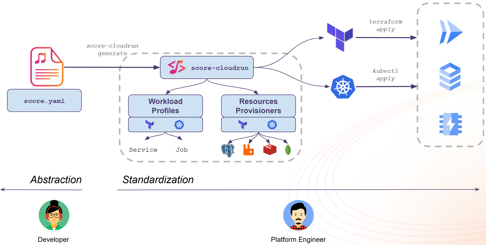

# Demo!



TOC:
- 

```bash
score-cloudrun init
```

## As Dev, I define a very basic workload

```yaml
apiVersion: score.dev/v1b1
metadata:
  name: example
containers:
  main:
    image: .
    variables:
      PODINFO_UI_COLOR: "#34577c"
      PODINFO_UI_MESSAGE: ""
```

The associated Cloud Run resources in Terraform can be generated:
```bash
score-cloudrun generate examples/score-basic.yaml \
    --location FIXME \
    --project-id FIXME \
    --image ghcr.io/stefanprodan/podinfo:latest \
    -o main.tf
```

And deploy them:
```bash
terraform init

terrraform plan -out out.tfplan

terrraform apply out.tfplan
```

## As Dev, I want to know what resource dependencies I can use alongside my workload

```bash
score-cloudrun provisioners list
```

```none
+----------+-------+------------------+------------------------------------------+-----------------------------------+
|   TYPE   | CLASS |      PARAMS      |                    OUTPUTS               |           DESCRIPTION             |
+----------+-------+------------------+------------------------------------------+-----------------------------------+
| dns      | (any) |                  | host                                     | Generate a DNS.                   |
+----------+-------+------------------+------------------------------------------+-----------------------------------+
| postgres | (any) |                  | database, host, password, port, username | Provisions a PostgreSQL database. |
+----------+-------+------------------+------------------------------------------+-----------------------------------+
| redis    | (any) |                  | host, password, port, username           | Provisions a Redis instance.      |
+----------+-------+------------------+------------------------------------------+-----------------------------------+
| route    | (any) | host, path, port |                                          | Provisions a ingress route.       |
+----------+-------+------------------+------------------------------------------+-----------------------------------+
```

## As Dev, I now want to use a Redis database

```yaml
apiVersion: score.dev/v1b1
metadata:
  name: example
containers:
  main:
    image: .
    variables:
      PODINFO_UI_COLOR: "#34577c"
      PODINFO_UI_MESSAGE: ""
      REDIS_HOST: ${resources.my-redis.host}
      REDIS_PORT: ${resources.my-redis.port}
      REDIS_USERNAME: ${resources.my-redis.username}
      REDIS_PASSWORD: ${resources.my-redis.password}
resources:
  my-redis:
    type: redis
```

The associated Cloud Run and dependencies resources in Terraform can be generated:
```bash
score-cloudrun generate examples/score-redis.yaml \
    --location FIXME \
    --project-id FIXME \
    --image ghcr.io/stefanprodan/podinfo:latest \
    -o main.tf
```

And deploy them:
```bash
terraform init

terrraform plan -out out.tfplan

terrraform apply out.tfplan
```

## As Dev, I now want to use a PostgreSQL database

```yaml
apiVersion: score.dev/v1b1
metadata:
  name: example
containers:
  main:
    image: .
    variables:
      PODINFO_UI_COLOR: "#34577c"
      PODINFO_UI_MESSAGE: ""
      REDIS_HOST: ${resources.my-redis.host}
      REDIS_PORT: ${resources.my-redis.port}
      REDIS_USERNAME: ${resources.my-redis.username}
      REDIS_PASSWORD: ${resources.my-redis.password}
      POSTGRES_HOST: ${resources.my-postgres.host}
      POSTGRES_DATABASE: ${resources.my-postgres.database}
      POSTGRES_PORT: ${resources.my-postgres.port}
      POSTGRES_USERNAME: ${resources.my-postgres.username}
      POSTGRES_PASSWORD: ${resources.my-postgres.password}
resources:
  my-redis:
    type: redis
  my-postgres:
    type: postgres
```

The associated Cloud Run and dependencies resources in Terraform can be generated:
```bash
score-cloudrun generate examples/score-redis-and-postgres.yaml \
    --location FIXME \
    --project-id FIXME \
    --image ghcr.io/stefanprodan/podinfo:latest \
    -o main.tf
```

And deploy them:
```bash
terraform init

terrraform plan -out out.tfplan

terrraform apply out.tfplan
```

## As Dev, I now want to expose my workload via a DNS

```yaml
apiVersion: score.dev/v1b1
metadata:
  name: example
containers:
  main:
    image: .
    variables:
      PODINFO_UI_COLOR: "#34577c"
      PODINFO_UI_MESSAGE: ""
      REDIS_HOST: ${resources.my-redis.host}
      REDIS_PORT: ${resources.my-redis.port}
      REDIS_USERNAME: ${resources.my-redis.username}
      REDIS_PASSWORD: ${resources.my-redis.password}
      POSTGRES_HOST: ${resources.my-postgres.host}
      POSTGRES_DATABASE: ${resources.my-postgres.database}
      POSTGRES_PORT: ${resources.my-postgres.port}
      POSTGRES_USERNAME: ${resources.my-postgres.username}
      POSTGRES_PASSWORD: ${resources.my-postgres.password}
service:
  ports:
    web:
      port: 8080
      targetPort: 9898
resources:
  my-redis:
    type: redis
  my-postgres:
    type: postgres
  my-route:
    type: route
    params:
      host: ${resources.dns.host}
      path: /
      port: 8080
```

The associated Cloud Run and dependencies resources in Terraform can be generated:
```bash
score-cloudrun generate examples/score-redis-and-postgres.yaml \
    --location FIXME \
    --project-id FIXME \
    --image ghcr.io/stefanprodan/podinfo:latest \
    -o main.tf
```

And deploy them:
```bash
terraform init

terrraform plan -out out.tfplan

terrraform apply out.tfplan
```

## As Dev, I now want to expose my workload via a DNS

## What's coming next

- `score-cloudrun generate --source`
- `score-cloudrun generate --format terraform|config-connector|knative`
- Job
- Volumes