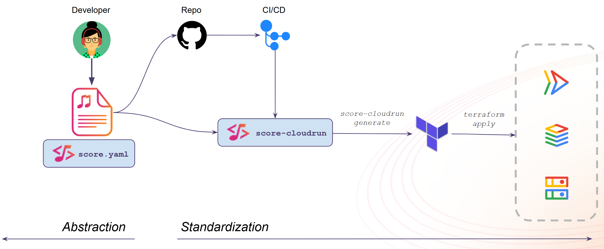
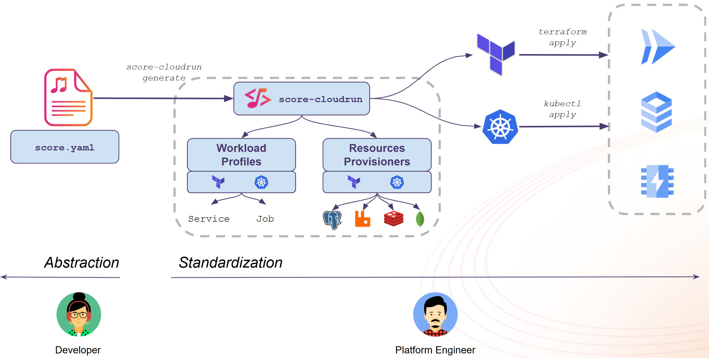

# `score-cloudrun` Demo!

## Context

Today's workflows:
- Devs deploy Cloud Run app via:
  1. `gcloud run deploy [--source]`
  2. UI
  3. YAML
  4. Terraform
- Ops (or Devs) deploy infrastructure dependencies via:
  - Terraform
  - UI
  - `gcloud`
  - KCC
  - Pulumi

Problems statements:
- Asking Devs to do Terraform is a reality but not the best experience, especially when they are comfortable to do `gcloud run deploy` or `git commit` from their local machine
- Frictions and delays are generated to inject and bind infrastructure to Cloud Run app (TicketOps, ClickOps, Shadow IT)
- Disconnection between the inner-loop (local) and the outer-loop (CD)

Objectives:
- Simplify applications development and deployment
- Improve productivity while staying compliant and secure

Example by [Shopify with their own custom `prod-kit` tool](https://youtu.be/aqjg1QRVed8):
> robust toolkit that empowers developers to seamlessly ship serverless applications while integrating with essential Google Cloud services and adhering to security best practices. Discover how to enhance scalability, reduce toil, and boost productivity.

Objectives:
- As Developer, I use the Score specification as a contract in order to describe what I need to deploy my workloads.
- As Platform Engineer, I author the Terraform manifests that will be used by `score-cloudrun` to centralize and standardize how the workloads and their infrastructure dependencies will actually be deployed in Cloud Run and associated Google Cloud services.



Let's start!

```bash
alias score-cloudrun=./score-cloudrun
```

## As Dev, I define a very basic workload

```yaml
apiVersion: score.dev/v1b1
metadata:
  name: example
containers:
  main:
    image: .
    variables:
      PODINFO_UI_COLOR: "#34577c"
      PODINFO_UI_MESSAGE: ""
```

The associated Cloud Run resources in Terraform can be generated:
```bash
score-cloudrun generate examples/score/score-basic.yaml \
    --location northamerica-northeast1 \
    --project-id my-project-123 \
    --image ghcr.io/stefanprodan/podinfo:latest \
    -o main.tf
```

And deploy them:
```bash
terraform init

terrraform plan -out out.tfplan

terrraform apply out.tfplan
```

```none
google_cloud_run_v2_service
google_service_account
```

## As Dev, I want to know what workload profiles and resource dependencies I can use alongside my workload

```bash
score-cloudrun provisioners list
```

```none
+----------+----------+-----------+------------------+------------------------------------------+-----------------------------------------------------------------------------+
|   TYPE   |  CLASS   |  FORMAT   |      INPUTS      |                 OUTPUTS                  |                                 DESCRIPTION                                 |
+----------+----------+-----------+------------------+------------------------------------------+-----------------------------------------------------------------------------+
| dns      | external | terraform |                  | host                                     | Makes the Cloud Run Service publicly available                              |
+----------+----------+-----------+------------------+------------------------------------------+-----------------------------------------------------------------------------+
| dns      | default  | terraform |                  | host                                     | Uses the default Cloud Run Service endpoint                                 |
+----------+----------+-----------+------------------+------------------------------------------+-----------------------------------------------------------------------------+
| postgres | default  | terraform |                  | database, host, password, port, username | Generates a Cloud SQL (PostgreSQL) instance and database Terraform resource |
+----------+----------+-----------+------------------+------------------------------------------+-----------------------------------------------------------------------------+
| redis    | default  | terraform |                  | port, username, host, password           | Generates a Memorystore (Redis) Terraform resource                          |
+----------+----------+-----------+------------------+------------------------------------------+-----------------------------------------------------------------------------+
| route    | default  | terraform | host, path, port |                                          | Defines an empty route                                                      |
+----------+----------+-----------+------------------+------------------------------------------+-----------------------------------------------------------------------------+
```

```bash
score-cloudrun profiles list
```

```none
+---------+-----------+---------------------------------------------------------------------------+
|  NAME   |  FORMAT   |                                DESCRIPTION                                |
+---------+-----------+---------------------------------------------------------------------------+
| default | terraform | Defines the default Workload profile as Cloud Run Service with Terraform. |
+---------+-----------+---------------------------------------------------------------------------+
| job     | terraform | Defines the Workload profile as Cloud Run Job with Terraform.             |
+---------+-----------+---------------------------------------------------------------------------+
```



## As Dev, I want to use a Redis database

```yaml
apiVersion: score.dev/v1b1
metadata:
  name: example
containers:
  main:
    image: .
    variables:
      PODINFO_UI_COLOR: "#34577c"
      PODINFO_UI_MESSAGE: ""
      REDIS_HOST: ${resources.my-redis.host}
      REDIS_PORT: ${resources.my-redis.port}
      REDIS_USERNAME: ${resources.my-redis.username}
      REDIS_PASSWORD: ${resources.my-redis.password}
resources:
  my-redis:
    type: redis
```

The associated Cloud Run and dependencies resources in Terraform can be generated:
```bash
score-cloudrun generate examples/score/score-redis.yaml \
    --location northamerica-northeast1 \
    --project-id my-project-123 \
    --image ghcr.io/stefanprodan/podinfo:latest \
    -o main.tf
```

And deploy them:
```bash
terraform init

terrraform plan -out out.tfplan

terrraform apply out.tfplan
```

```none
google_cloud_run_v2_service
google_service_account
google_redis_instance
google_secret_manager_secret
google_secret_manager_secret_version
google_secret_manager_secret_iam_member
```

## As Dev, I now want to use a PostgreSQL database

```yaml
apiVersion: score.dev/v1b1
metadata:
  name: example
containers:
  main:
    image: .
    variables:
      PODINFO_UI_COLOR: "#34577c"
      PODINFO_UI_MESSAGE: ""
      REDIS_HOST: ${resources.my-redis.host}
      REDIS_PORT: ${resources.my-redis.port}
      REDIS_USERNAME: ${resources.my-redis.username}
      REDIS_PASSWORD: ${resources.my-redis.password}
      POSTGRES_HOST: ${resources.my-postgres.host}
      POSTGRES_DATABASE: ${resources.my-postgres.database}
      POSTGRES_PORT: ${resources.my-postgres.port}
      POSTGRES_USERNAME: ${resources.my-postgres.username}
      POSTGRES_PASSWORD: ${resources.my-postgres.password}
resources:
  my-redis:
    type: redis
  my-postgres:
    type: postgres
```

The associated Cloud Run and dependencies resources in Terraform can be generated:
```bash
score-cloudrun generate examples/score/score-redis-and-postgres.yaml \
    --location northamerica-northeast1 \
    --project-id my-project-123 \
    --image ghcr.io/stefanprodan/podinfo:latest \
    -o main.tf
```

And deploy them:
```bash
terraform init

terrraform plan -out out.tfplan

terrraform apply out.tfplan
```

```none
google_cloud_run_v2_service
google_service_account
google_sql_database_instance
google_sql_database
google_sql_user
google_redis_instance
google_secret_manager_secret
google_secret_manager_secret_version
google_secret_manager_secret_iam_member
```

## As Dev, I now want to expose my workload via a DNS

```yaml
apiVersion: score.dev/v1b1
metadata:
  name: example
containers:
  main:
    image: .
    variables:
      PODINFO_UI_COLOR: "#34577c"
      PODINFO_UI_MESSAGE: ""
      REDIS_HOST: ${resources.my-redis.host}
      REDIS_PORT: ${resources.my-redis.port}
      REDIS_USERNAME: ${resources.my-redis.username}
      REDIS_PASSWORD: ${resources.my-redis.password}
      POSTGRES_HOST: ${resources.my-postgres.host}
      POSTGRES_DATABASE: ${resources.my-postgres.database}
      POSTGRES_PORT: ${resources.my-postgres.port}
      POSTGRES_USERNAME: ${resources.my-postgres.username}
      POSTGRES_PASSWORD: ${resources.my-postgres.password}
service:
  ports:
    web:
      port: 8080
      targetPort: 9898
resources:
  my-redis:
    type: redis
  my-postgres:
    type: postgres
  my-dns:
    type: dns
  my-route:
    type: route
    params:
      host: ${resources.my-dns.host}
      path: /
      port: 8080
```

The associated Cloud Run and dependencies resources in Terraform can be generated:
```bash
score-cloudrun generate examples/score/score-redis-and-postgres-and-dns.yaml \
    --location northamerica-northeast1 \
    --project-id my-project-123 \
    --image ghcr.io/stefanprodan/podinfo:latest \
    -o main.tf
```

And deploy them:
```bash
terraform init

terrraform plan -out out.tfplan

terrraform apply out.tfplan
```

```none
google_cloud_run_v2_service
google_service_account
google_cloud_run_service_iam_policy
google_sql_database_instance
google_sql_database
google_sql_user
google_redis_instance
google_secret_manager_secret
google_secret_manager_secret_version
google_secret_manager_secret_iam_member
```

## As Dev, I now want to test my workload and dependencies locally

Same Score file, but now we use `score-compose` to generate the Docker Compose file:
```bash
score-compose init

score-compose generate examples/score/score-redis-and-postgres-and-dns.yaml \
    --image ghcr.io/stefanprodan/podinfo:latest \
    -o compose.yaml
```

And deploy them:
```bash
docker compose up --build -d --wait --remove-orphans
```

```none
CONTAINER ID   IMAGE                                 COMMAND                  CREATED       STATUS                    PORTS                                     NAMES
72fa0a7182ac   mirror.gcr.io/nginx:1-alpine          "/docker-entrypoint.…"   3 hours ago   Up 12 minutes             0.0.0.0:8080->80/tcp, [::]:8080->80/tcp   score-cloudrun-routing-MflvHg-1
83cf4335b8cd   ghcr.io/stefanprodan/podinfo:latest   "./podinfo"              3 hours ago   Up 1 second                                                         score-cloudrun-example-main-1
7e55f78bcf38   mirror.gcr.io/redis:7-alpine          "redis-server /usr/l…"   3 hours ago   Up 12 minutes             6379/tcp                                  score-cloudrun-redis-Li8iSC-1
ae3c395e038b   mirror.gcr.io/postgres:17-alpine      "docker-entrypoint.s…"   3 hours ago   Up 12 minutes (healthy)   5432/tcp                                  score-cloudrun-pg-hNX58v-1
```

## What's coming next

- More features like Volumes, Traffic, etc.
- Officially releasing this at KubeCon NA 2025 Atlanta
- We need your feedback!

## Function (`--source`)

The associated Cloud Run and dependencies resources in Terraform can be generated:
```bash
score-cloudrun generate examples/score/score-source.yaml \
    --location northamerica-northeast1 \
    --project-id my-project-123 \
    --image us-central1-docker.pkg.dev/my-repo/my-image \
    --source examples/app/index.js \
    -o main.tf
```

## Knative

FIXME

## KCC

FIXME